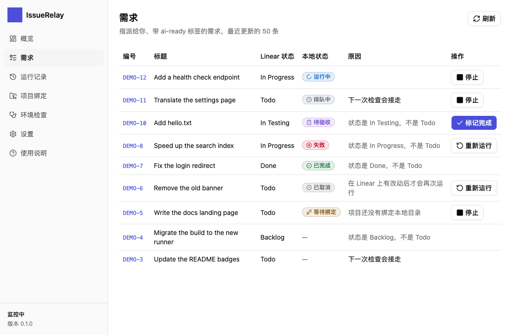
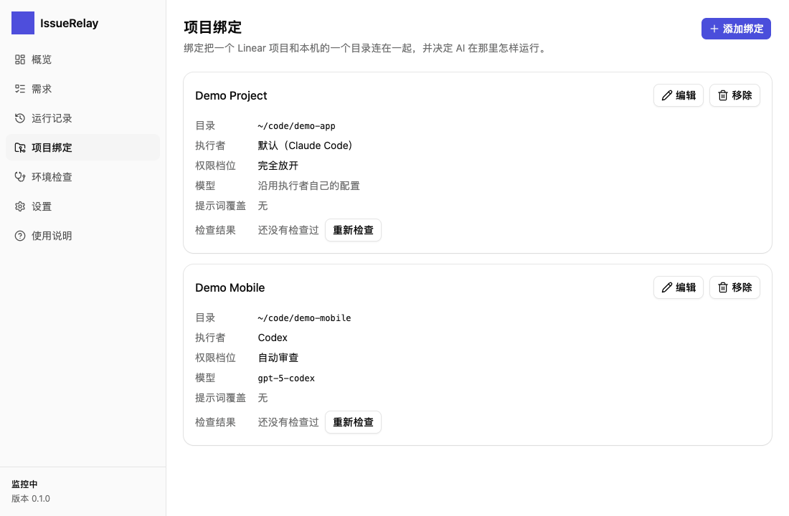
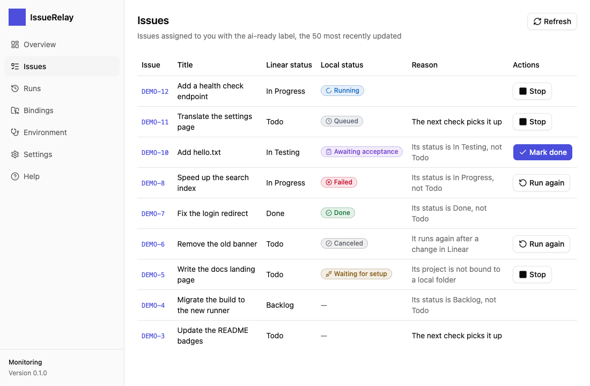
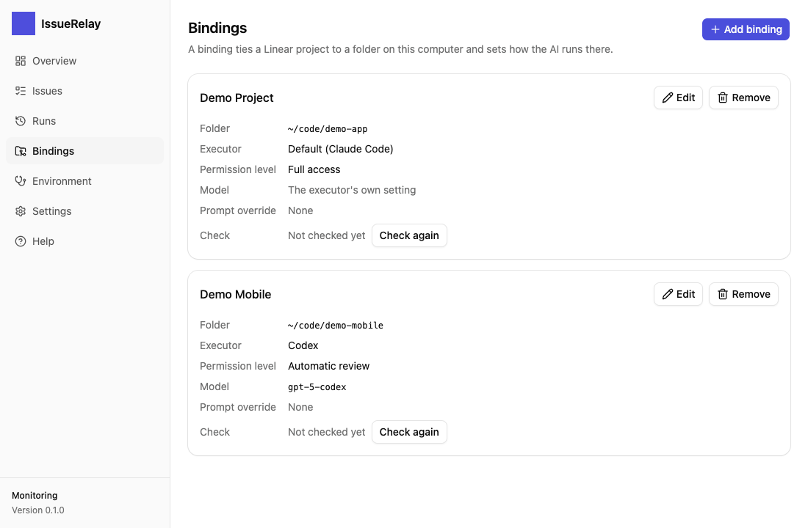

# IssueRelay

把 Linear 上指派给你的需求，自动交给你电脑上的 Claude Code 或 Codex 去完成。

*Hand the Linear issues assigned to you to Claude Code or Codex on your own machine.*

> **状态：开发中，尚未发布。** 当前在做 M0（实测验证）和 M1（引擎与命令行）；桌面面板与安装包在 M2、M3。
> *Status: under development, not released yet.*

## 安装 / Install

从 [GitHub Releases](https://github.com/sunkailun1992/issuerelay/releases/latest) 下载：Mac 用 `IssueRelay_<版本>_universal.dmg`，Windows 用 `IssueRelay_<版本>_x64-setup.exe`（不需要管理员权限）。需要 macOS 13.3 及以后。没有经过 Apple 公证或 Windows 代码签名的版本（每个版本的发布说明写明），第一次打开要放行一次；经过公证、签名的版本通常没有这一步。步骤、把命令行加入 PATH、自动更新与卸载见 [安装说明](docs/install.md)。

Download from [GitHub Releases](https://github.com/sunkailun1992/issuerelay/releases/latest): `IssueRelay_<version>_universal.dmg` for macOS, `IssueRelay_<version>_x64-setup.exe` for Windows (no administrator rights needed). macOS 13.3 or later. Unsigned builds (each release's notes say whether it is notarized by Apple and code-signed for Windows) need one approval at the first start (macOS 15+: System Settings → Privacy & Security → Open Anyway; Windows: More info → Run anyway); signed builds, when available, usually do not. See [docs/install.md](docs/install.md) (Chinese) for the steps, putting the CLI on PATH, automatic updates and uninstalling.

## 它怎么工作

```text
Linear（指派给你 · 带 ai-ready · 状态 Todo）
   │  每 30 秒查一次（Linear 官方 MCP，OAuth 授权）
   ▼
IssueRelay（你电脑上的托盘程序）
   │  按「Linear 项目 → 本地目录」的绑定找到工作目录；同一目录一次只跑一条
   ▼
Claude Code / Codex（无人值守运行，用你自己的登录）
   │  读需求 → 改代码 → 推测试分支 → 把状态改成 In Testing，并留言（以「🤖 IssueRelay」开头）
   ▼
你验收后，在面板上点「标记完成」→ Linear 状态变为 Done
```

## 一条需求要被自动处理，必须同时满足

1. 指派给你；
2. 带标签 `ai-ready`；
3. 状态是 `Todo`；
4. 所属 Linear 项目已在 IssueRelay 里绑定了本地目录。

## 界面预览 / Screenshots

桌面面板的两个页面：需求列表（每条需求在 Linear 上的状态、本地的状态、为什么没被接走，以及能做的操作），和项目绑定（每个 Linear 项目对应的本地目录、执行者与权限档位）。截图只用内置假后端的虚构数据（`DEMO-N`、`Demo Project`、`Jane Doe`），侧栏左上角的应用图标在截图里遮成了一块靛蓝；两种语言、浅色与深色共 48 张都在 [docs/gates/screenshots/m2](docs/gates/screenshots/m2/)。

*Two pages of the desktop panel: the issues (each one's status in Linear, its local state, why it was not picked up, and what can be done) and the project bindings (the folder, executor and permission level of each Linear project). The screenshots show only the fictional data of the built-in mock backend, and the app icon is masked as an indigo square; all 48 (two languages, light and dark) are in [docs/gates/screenshots/m2](docs/gates/screenshots/m2/).*

**中文界面**





**English interface**





## 安全须知

- **默认以「完全放开」权限无人值守运行 AI**：它能执行任意命令、使用你电脑上的全部凭据。只在你信任的仓库和需求上使用；可以按项目调低档位。
- AI 被要求遵守三条固定规则：不把状态设为 Done、不推主分支、不发正式环境。这些规则写在提示词里，约束力取决于 AI 本身，请同时为主分支开启分支保护。
- AI 用的是你本机 Claude Code / Codex 的全部配置：用户级指令文件、插件、hooks 和所有 MCP 服务器都会生效，它们也会影响无人值守运行。
- Linear 令牌只存在系统钥匙串（macOS 钥匙串、Windows 凭据管理器）。IssueRelay 不上传任何数据，也没有遥测。

## 开发

需要 Rust 1.99：装好 rustup 后在仓库根目录运行 `rustup toolchain install`（按 `rust-toolchain.toml` 安装 1.99.0 及 rustfmt、clippy）。桌面面板（`app/`）还需要 Node.js 22.22.2+、24.15+ 或 26 及以上和 pnpm（版本见 `app/package.json` 的 `engines` 与 `packageManager`）。

```bash
cargo test --workspace
cargo run -p issuerelay-devhost -- --help   # 开发用无界面宿主（不发布）；启动不等 Linear（连接在后台进行，结果写进日志），没有登录时也会启动，并提示先登录
cargo run -p issuerelay-cli -- --help       # 命令行
pnpm --dir app install                      # 面板的前端依赖
pnpm --dir app tauri dev                    # 启动桌面应用开发版
pnpm --dir app dev                          # 只在浏览器里看面板，用假数据
pnpm --dir app test:screens                 # 面板截图比对与版面检查，只在本机运行，不进 CI
```

`pnpm --dir app build` 排在 cargo 命令之前：`pnpm --dir app tauri build`（打开 `custom-protocol` 特性）构建的应用内嵌 `app/dist`，它会自己先构建；`tauri dev`、`cargo test` 等调试构建不内嵌、连开发服务器。

提交前的检查、代码规范与开发流程见 [AGENTS.md](AGENTS.md) 和 [docs/ai-coding](docs/ai-coding/README.md)。

## 参与贡献 / Contributing

欢迎 issue 和 PR。动手前请先读 [CONTRIBUTING.md](CONTRIBUTING.md)。
Issues and pull requests are welcome. Please read [CONTRIBUTING.md](CONTRIBUTING.md) first.

- [CONTRIBUTING.md](CONTRIBUTING.md)：开发环境、提交前检查、PR 流程 / setup, checks, pull requests
- [CODE_OF_CONDUCT.md](CODE_OF_CONDUCT.md)：行为准则 / code of conduct
- [SECURITY.md](SECURITY.md)：私下报告安全问题 / report vulnerabilities privately
- [MAINTAINERS.md](MAINTAINERS.md)：维护者、评审与合并规则 / maintainers and merge rules

## 文档

| 文档 | 内容 |
|---|---|
| [设计](docs/superpowers/specs/2026-10-10-issuerelay-design.md) | 目标、关键决定、整体结构、需求的生命周期 |
| [实施计划](docs/superpowers/plans/2026-10-10-issuerelay-m0-m1.md) | M0–M1 的分步任务 |
| [验收报告](docs/gates/) | 每次实机验收的结果 |
| [AI 编码规范](docs/ai-coding/README.md) | 分层、目录、注释、设计模式、门禁、安全、测试、流程 |

## 许可证

[Apache-2.0](LICENSE)
