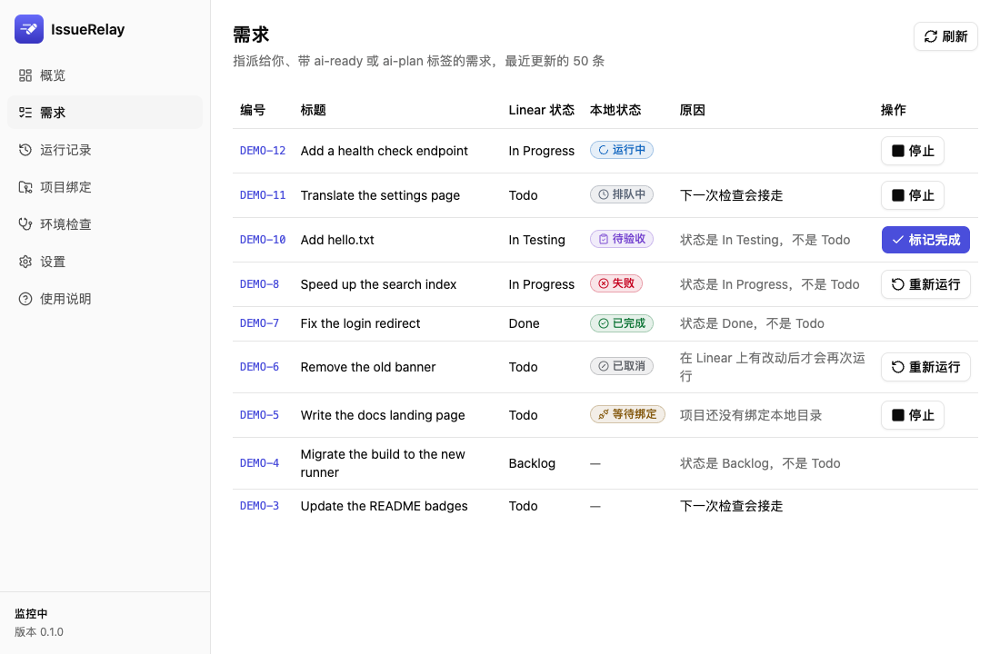
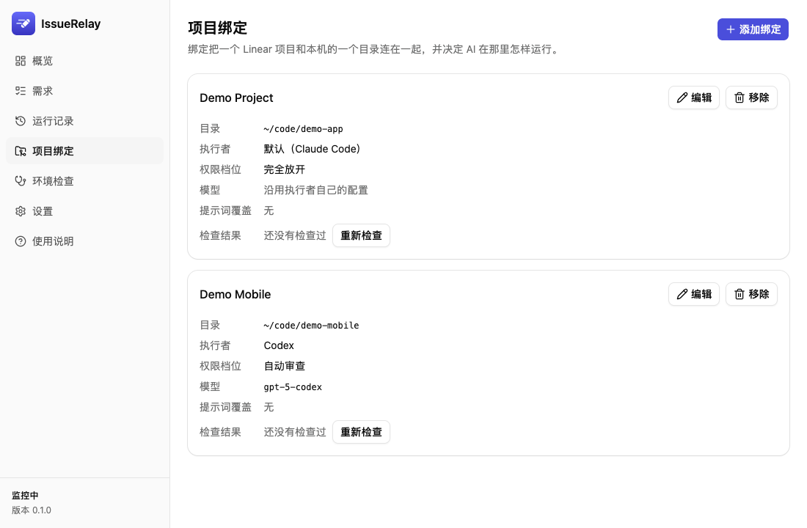
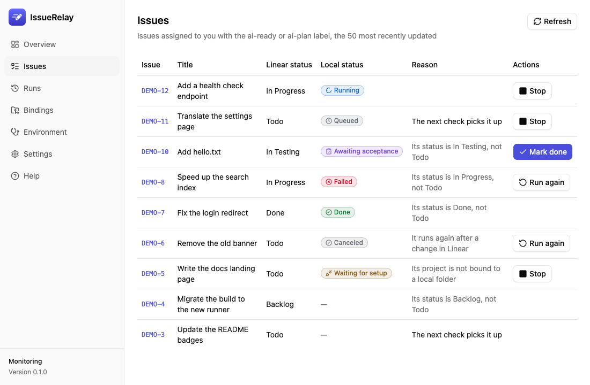
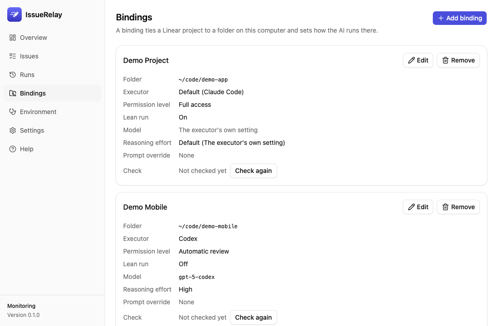

# IssueRelay

**简体中文** · [繁體中文](docs/locales/README.zh-TW.md) · [English](docs/locales/README.en.md) · [日本語](docs/locales/README.ja.md) · [한국어](docs/locales/README.ko.md)

**连接 Linear 与本机 Codex / Claude Code 的桌面任务调度器。**

你在 Linear 中准备需求并标记运行模式，在 IssueRelay 面板预览并确认派发。IssueRelay 按项目绑定启动编码 AI，并保存运行状态、摘要、日志和用量，供你跟进与验收。它适合已经使用 Linear 和本机编码 AI、希望把任务派发与运行跟踪集中起来的开发者。

*A desktop task scheduler connecting Linear to Codex or Claude Code on your own machine. Prepare an issue in Linear, choose a mode, and approve the dispatch preview in IssueRelay. IssueRelay starts the configured coding agent and tracks its run.*

初次了解产品，先看下方职责与流程。完整说明见 [使用指南](docs/usage.md)，安装与连接步骤见 [安装说明](docs/install.md)。

> 工作流说明对应仓库当前源码。安装包包含的功能以各版本的发布说明为准。 [Releases](https://github.com/sunkailun1992/issuerelay/releases) · [验收报告](docs/gates/)

## 谁负责什么

| 角色 | 职责 |
|---|---|
| 你 | 明确目标与验收要求，确认派发预览，检查结果并确认完成 |
| Linear | 保存需求、指派、标签、依赖、状态和讨论 |
| IssueRelay | 发现符合条件的需求，分流、排队、启动执行者，处理运行生命周期并保存记录 |
| Codex / Claude Code | 读取需求与仓库，分析或修改代码，通过自己的工具操作 git、测试和 Linear |
| Skills 与项目规则 | 给执行者提供工作方法与约束；实际加载范围取决于运行模式 |

你可以让 Codex 或 Claude Code 整理本次任务的摘要、完整任务相关会话文字和 Wiki 引用，并通过 IssueRelay MCP 提交上下文草稿。Linear 标记运行模式后，在桌面面板核对预览中的内容、Wiki 目录和执行去向，再确认派发。直接在 Linear 编写、没有前序会话的需求也走预览，面板明确显示没有会话上下文；提交了上下文的任务则必须带任务相关历史。每次运行使用一个执行者，依次采用需求显式选择、项目绑定、登记入口和全局默认。

## 它怎么工作

```text
你准备 Linear 需求
  指派给自己 + Todo + ai-plan 或 ai-ready + 已绑定的项目
       │
       ▼
IssueRelay：发现候选 → 面板预览并确认 → 按绑定与依赖排队 → 启动执行者
       │                                  同一目录一次只跑一条
       ├─ ai-plan  → AI 读需求和代码 → 把方案写回这条需求的评论
       │
       └─ ai-ready → AI 实现并验证
                       ├─ 仅本地范围 → 运行显示待验收
                       └─ 已获准提测 → 推测试分支并交到 In Testing
                                             │
                                             ▼
                         你验收 → 按需登记 Wiki 归档回执 → 在面板标记完成
```

默认每 30 秒经 Linear 官方 MCP 检查一次，使用你授权的账户；触发名称可配置。只出方案与开发是两种运行模式，方案不会自动变成开发任务。开发模式的 AI 被要求遵守三条固定规则：不设 Done、不推主分支、不发正式环境；具体执行仍须符合目标仓库的规则和你的授权。

## 一条需求要被自动处理，必须同时满足

1. 指派给你；
2. 带 `ai-ready`，或只要方案时带 `ai-plan`；
3. 状态为 `Todo`；
4. 所属 Linear 项目已绑定本地目录；同一项目有多个绑定时，按分流标签选择；
5. 选定执行者已安装、登录，并通过对应运行模式的环境检查。
6. 你已在桌面面板或 MCP 客户端的确认表单中批准当前派发预览。

开发需求被未完成的需求阻塞（blocked by）时先等待。方案模式无需等待这些依赖完成。开着监控时，符合条件的 Linear 标签会让需求进入候选列表。需求变更、执行去向改变、提交新草稿或手动重跑时，需要再次确认。

## Codex / Claude 怎样连接 IssueRelay

这里有两条方向不同的 MCP 连接：

- **IssueRelay → Linear MCP**：IssueRelay 发现需求，编码 AI 也需要自己的 Linear 连接来读取需求、写评论和更新状态。IssueRelay 的 Linear 登录与执行者的登录分别配置。
- **Codex / Claude Code → IssueRelay MCP**：你在 AI 会话中登记需求上下文、查看进度、读取交接与复核资料，或控制监控。这个控制服务通过本机通信访问正在运行的 IssueRelay。

在面板的“设置 → MCP 控制服务”中注册，步骤见 [安装说明](docs/install.md#把命令行加入-path)。现有工具如下：

| MCP 工具 | 用途 |
|---|---|
| `status` | 读取监控、连接、运行与等待状态 |
| `list_jobs` | 读取近期运行记录 |
| `pause` | 暂停监控与派发；已经在运行的任务继续 |
| `resume` | 恢复监控，随后检查可处理的需求 |
| `poll_now` | 请求立即检查；暂停时不执行轮询，也不解除暂停 |
| `get_run` | 按运行 ID 或 Linear 需求编号读取运行详情 |
| `get_issue_context` / `set_issue_context` | 读取最新草稿或已保存上下文，按修订号提交内存草稿 |
| `get_handoff` | 读取运行交接、复核提示词与归档材料。当前保留的标识是 `claim_id` |
| `claim_handoff` / `release_handoff` | 手动接手前保留目录。接手会话结束后，用 `job_id` 和自己取得的本次 `claim_id` 释放 |
| `record_archive` | 为当前 Wiki 目录登记已写入的页面及提交回执 |
| `get_control_capabilities` | 查看会话可用操作及客户端声明的表单能力 |
| `preview_task_action` / `confirm_task_action` | 预览、确认派发、续作、重试、停止、完成、项目绑定和部分运行设置 |

`resume` 恢复监控。用户确认后，任务相关上下文随获准的运行快照传给执行者。主控会话可提供复现命令、报错原文、版本和决定。请排除整段聊天、原始截图和凭据。会话中的任务操作使用客户端原生表单确认，宿主随后重新核对当前状态。参数和可用范围见[使用指南](docs/usage.md#用-mcp-连接主控会话)和[聊天控制覆盖表](docs/chat-controls.md)。

## 当前能力与范围

| 能力 | 当前支持情况 |
|---|---|
| 方案与开发 | `ai-plan` 只出方案；`ai-ready` 执行开发流程 |
| 本地交付 | 本地实现与验证完成后，运行显示「待验收」。详情说明本地验证结果，Linear 状态独立显示。符合条件的旧运行也可在桌面详情经人工确认后记录。 [操作条件](docs/usage.md#只做本地实现与验证) |
| 派发预览 | 在桌面面板核对脱敏摘要、Wiki 引用、运行模式与执行去向，确认后保存并进入派发流程 |
| 多项目调度 | 按项目与分流标签绑定目录，支持依赖等待、目录互斥和总并发限制 |
| 执行者与模型 | 需求显式选择 → 项目绑定 → 登记入口 → 全局默认。默认模型与绑定中的模型都可配置 |
| 会话接续 | 在中断的运行详情点「继续上次」，选择 Codex 或 Claude Code，确认接续方式、工作目录和交接内容 |
| 用量记录 | 展示执行者报告的 token；Claude 的费用为估算，不等于订阅实际扣费 |
| 额度耗尽与手动接力 | 确认额度耗尽后停止自动重跑。你可以保留工作目录，把已保存的检查点交给新的 Codex 或 Claude 会话 |
| 独立复核 | 从运行详情复制复核提示词，在新会话中核对 diff、测试和验收条件 |
| Wiki 归档 | 配置 Wiki 目录后，可复制归档材料。回执绑定当前目录，换目录或页面失效后需要重新登记 |

运行完成、测试通过、制品部署和业务验收是不同结果。请结合运行记录、Linear 评论、代码改动与实际验证判断是否完成；最终 Done 由你在面板确认。更多边界与常见问题见 [使用指南](docs/usage.md)。

## 安装 / Install

从 [GitHub Releases](https://github.com/sunkailun1992/issuerelay/releases/latest) 下载：Mac 用 `IssueRelay_<版本>_universal.dmg`，Windows 用 `IssueRelay_<版本>_x64-setup.exe`（不需要管理员权限）。需要 macOS 13.3 及以后。没有经过 Apple 公证或 Windows 代码签名的版本（每个版本的发布说明写明），第一次打开要放行一次（macOS 15 及以后：系统设置 → 隐私与安全性 → 仍要打开；Windows：更多信息 → 仍要运行）；经过公证、签名的版本通常没有这一步。通知由系统显示：macOS 上一条都看不到时，到「系统设置 → 通知 → IssueRelay」打开「允许通知」，它关着时 IssueRelay 自己看不出来。步骤、把命令行加入 PATH、自动更新与卸载见 [安装说明](docs/install.md)。

Download from [GitHub Releases](https://github.com/sunkailun1992/issuerelay/releases/latest): `IssueRelay_<version>_universal.dmg` for macOS, `IssueRelay_<version>_x64-setup.exe` for Windows (no administrator rights needed). macOS 13.3 or later. Unsigned builds (each release's notes say whether it is notarized by Apple and code-signed for Windows) need one approval at the first start (macOS 15+: System Settings → Privacy & Security → Open Anyway; Windows: More info → Run anyway); signed builds, when available, usually do not. Notifications are shown by the system: on macOS, if none appear, turn on Allow Notifications in System Settings → Notifications → IssueRelay; IssueRelay cannot tell when it is off. See [docs/install.md](docs/install.md) (Chinese) for the steps, putting the CLI on PATH, automatic updates and uninstalling.

升级前，正常退出 IssueRelay 并备份应用数据。支持本地交付结果的构建会将运行数据库迁移至 schema 6。退回只支持 schema 5 的构建时，恢复升级前的备份。 [升级与备份](docs/install.md#升级前备份数据)

Before upgrading, quit IssueRelay normally and back up its application data. Builds that record local delivery outcomes migrate the run database to schema 6. Restore the pre-upgrade backup before returning to a build that supports only schema 5. [Upgrade and backup instructions](docs/install.md#升级前备份数据)

## 更多用法

- **只出方案**：带 `ai-plan`（而不是 `ai-ready`）的需求，AI 读需求和代码，把方案写成一条评论；改文件的工具都关掉，Linear 的工具也只留读取、评论和修改这条需求本身的。方案合适后，在运行详情点「执行开发」。如果当前需求还没准备好，按提示在 Linear 将它设为 Todo、指派给自己并添加 `ai-ready`，再回到预览确认。满足续跑条件时，执行器会尝试接着方案会话动手。
- **一个项目分到几个目录**：绑定可以带分流标签（从 Linear 的标签里选），只接带其中任一标签的需求，用自己的目录和队列；不带标签的绑定接其余的需求。
- **Linear 上的改动会停掉运行**：正在运行的需求在 Linear 上被取消、完成、改派或删除时，下一次检查就停掉运行（结束整棵进程树），运行记录写明原因。暂停监控时不查。
- **继续上次**：在中断运行的详情选择接手执行器，预览并确认原会话恢复或新会话交接。两种方式都沿用原项目工作目录，并记录新一次尝试。也可在原执行器的官方客户端查看原生会话。具体条件见[继续中断的运行](docs/usage.md#继续中断的运行)。
- **用量**：运行详情显示用了多少 token，Claude 的还有按 API 价格估算的花费；用订阅登录 Claude Code 时，这不是实际扣费。命令行 `issuerelay jobs` 也有花费一栏。
- **模型与推理**：在设置或绑定中选模型，也可以输入自定义模型。Codex 可刷新原生目录，支持的模型才提供 Ultra。Claude 的 Ultracode 是独立开关，可和推理力度一起使用。

## 界面预览 / Screenshots

桌面面板的两个页面：需求列表（每条需求在 Linear 上的状态、本地的状态、为什么没被接走，以及能做的操作），和项目绑定（每个绑定的本地目录、分流标签、执行者、权限档位、精简运行与推理力度）。截图只用内置假后端的虚构数据（`DEMO-N`、`Demo Project`、`Jane Doe`）；两种语言、浅色与深色共 48 张比对用的截图都在 [docs/gates/screenshots/m2](docs/gates/screenshots/m2/)。

*Two pages of the desktop panel: the issues (each one's status in Linear, its local state, why it was not picked up, and what can be done) and the project bindings (the folder, routing labels, executor, permission level, lean runs and reasoning effort of each binding). The screenshots show only the fictional data of the built-in mock backend; all 48 that the comparison uses (two languages, light and dark) are in [docs/gates/screenshots/m2](docs/gates/screenshots/m2/).*

**中文界面**





**English interface**





## 安全须知

- **默认以「完全放开」权限无人值守运行 AI**：它能执行任意命令、使用你电脑上的全部凭据。只在你信任的仓库和需求上使用；可以按项目调低档位。
- AI 被要求遵守三条固定规则：不把状态设为 Done、不推主分支、不发正式环境。这些规则写在提示词里，约束力取决于 AI 本身，请同时为主分支开启分支保护。
- **默认是精简运行**：无人值守运行只带 Linear 的 MCP 服务和目标仓库自己的规则与设置（`CLAUDE.md` / `AGENTS.md`、`.claude/settings.json` 和项目钩子），不带你的其他 MCP 服务、插件、用户级技能与钩子、自动记忆和用户级 `CLAUDE.md`。它缩小的是这一面，不是沙箱：AI 仍以你的身份运行，能用你的 git、SSH 和各种命令行凭据。
  - Codex 仍读 `~/.codex/AGENTS.md`，仓库的 `.codex/` 配置也不生效。
  - 精简运行不读你的用户级设置，写在那里的拒绝规则（例如挡危险命令的规则）也不生效；靠它们的话，把规则放进项目的 `.claude/settings.json`，或关掉这个绑定的精简运行。推理力度同样不从那里读，在设置页或绑定里设。
  - 用户设置的 `env` 把 Claude Code 接到网关或代理（`ANTHROPIC_BASE_URL`、`HTTPS_PROXY` 等）时，精简运行会绕过它们，所以环境检查判 Claude 的精简运行不可用，并写明是哪个变量；这时请关掉这个绑定的精简运行。
  - IssueRelay 为 Claude 指定推理力度时，CLI 参数和该子进程的 `CLAUDE_CODE_EFFORT_LEVEL` 使用同一个值。未指定力度时，执行者沿用自己的环境和设置。IssueRelay 不改用户的全局配置。
  - 管理员下发了 MCP 配置（`managed-mcp.json`）的电脑上，Claude 的精简运行会在启动时失败，运行记录里有 Claude 的原文；关掉精简运行即可。
  - 要用别的 MCP 服务、仓库的 `.codex/` 配置、用户设置里的拒绝规则或自定义模型服务的绑定，在面板里关掉精简运行。关掉精简运行才加载全部配置：你本机 Claude Code / Codex 的用户级指令文件、插件、hooks 和所有 MCP 服务器都会生效；「按个人设置」档位和绑定到主目录的绑定也总是这样。
- **只出方案的运行**（`ai-plan`）同样无人值守、以你的身份运行。Claude 的内置工具只剩读文件的 Read、Grep、Glob，Codex 用只读沙箱；Linear 的工具只留读取、评论和修改这条需求本身的，关掉其余 29 个（例如合并、审批需求关联的拉取请求，删除评论；Codex 只在精简运行时能关）。除「按个人设置」的绑定外，它总是精简运行（只带 Linear 一个 MCP 服务），不看绑定的精简开关，所以绑定到主目录的绑定出不了方案。它仍能读你能读的文件，并把方案写进 Linear 的评论，能看到这条需求的人都看得到。「按个人设置」的绑定沿用你自己的设置与 MCP 服务，Linear 的工具要在你的设置里允许过，否则留不下方案。
- 无人值守运行里，需求要求「先等一会儿」的步骤可能失败：放到后台的命令会让运行提前结束，单独的长时间 `sleep` 会被 Claude Code 拦下。这类需求请写成可以直接检查的条件。
- Linear 登录凭据由系统钥匙串保存（macOS 钥匙串、Windows 凭据管理器）。IssueRelay 没有遥测或自建云端任务中转服务；它会连接 Linear，编码 AI 也会按各自配置访问模型和工具服务。任务在本机调度不代表全程离线，需求与代码等输入的发送范围取决于实际执行者和工具配置。

## 开发

需要 Rust 1.99：装好 rustup 后在仓库根目录运行 `rustup toolchain install`（按 `rust-toolchain.toml` 安装 1.99.0 及 rustfmt、clippy）。桌面面板（`app/`）还需要 Node.js 22.22.2+、24.15+ 或 26 及以上和 pnpm（版本见 `app/package.json` 的 `engines` 与 `packageManager`）。

```bash
cargo test --workspace
cargo run -p issuerelay-devhost -- --help   # 开发用无界面宿主（不发布）；启动不等 Linear（连接在后台进行，结果写进日志），没有登录时也会启动，并提示先登录
cargo run -p issuerelay-cli -- --help       # 命令行
pnpm --dir app install                      # 面板的前端依赖
pnpm --dir app tauri dev                    # 启动桌面应用开发版
pnpm --dir app dev                          # 只在浏览器里看面板，用假数据
pnpm --dir app test:screens                 # 面板截图比对与版面检查，只在本机运行，不进 CI
```

`pnpm --dir app build` 排在 cargo 命令之前：`pnpm --dir app tauri build`（打开 `custom-protocol` 特性）构建的应用内嵌 `app/dist`，它会自己先构建；`tauri dev`、`cargo test` 等调试构建不内嵌、连开发服务器。

提交前的检查、代码规范与开发流程见 [AGENTS.md](AGENTS.md) 和 [docs/ai-coding](docs/ai-coding/README.md)。

## 参与贡献 / Contributing

欢迎 issue 和 PR。动手前请先读 [CONTRIBUTING.md](CONTRIBUTING.md)。
Issues and pull requests are welcome. Please read [CONTRIBUTING.md](CONTRIBUTING.md) first.

- [CONTRIBUTING.md](CONTRIBUTING.md)：开发环境、提交前检查、PR 流程 / setup, checks, pull requests
- [CODE_OF_CONDUCT.md](CODE_OF_CONDUCT.md)：行为准则 / code of conduct
- [SECURITY.md](SECURITY.md)：私下报告安全问题 / report vulnerabilities privately
- [MAINTAINERS.md](MAINTAINERS.md)：维护者、评审与合并规则 / maintainers and merge rules

## 文档

| 文档 | 内容 |
|---|---|
| [使用指南](docs/usage.md) | 运行模式、MCP 登记、模型、手动接力、独立复核与 Wiki 归档 |
| [安装说明](docs/install.md) | 安装包、首次引导、执行者连接、MCP 注册、更新与卸载 |
| [设计](docs/superpowers/specs/2026-10-10-issuerelay-design.md) | 目标、关键决定、整体结构、需求的生命周期 |
| [运行改进设计](docs/superpowers/specs/2026-10-27-issuerelay-run-improvements-design.md) | 只出方案、按标签分流、被挡住先不派、Linear 上停掉运行、接续会话、用量 |
| [实施计划](docs/superpowers/plans/2026-10-10-issuerelay-m0-m1.md) | M0–M1 的分步任务 |
| [验收报告](docs/gates/) | 每次实机验收的结果 |
| [AI 编码规范](docs/ai-coding/README.md) | 分层、目录、注释、设计模式、门禁、安全、测试、流程 |

## 许可证

[Apache-2.0](LICENSE)
