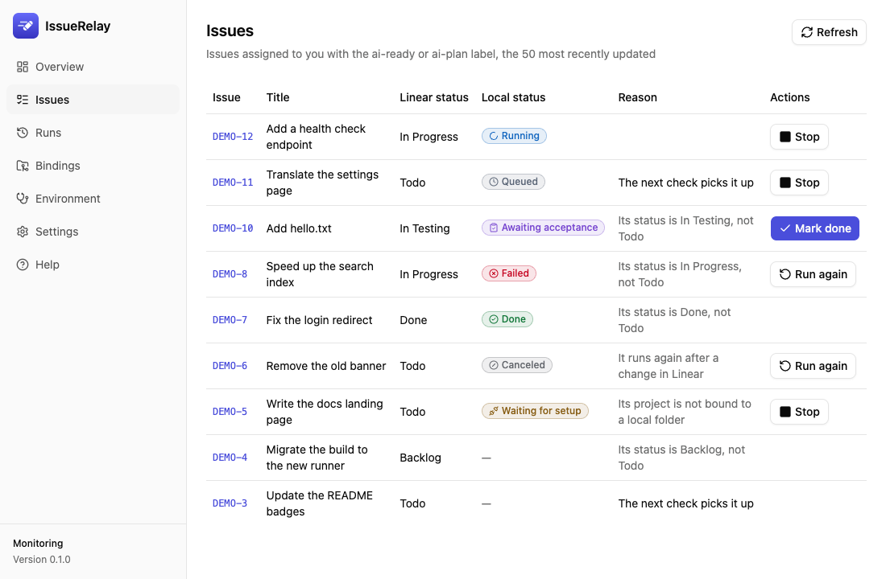
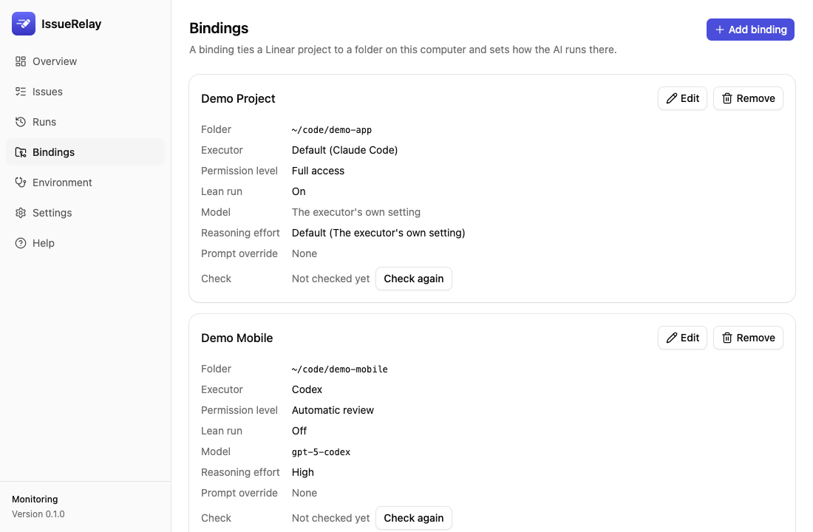

# IssueRelay

[简体中文](../../README.md) · [繁體中文](README.zh-TW.md) · **English** · [日本語](README.ja.md) · [한국어](README.ko.md)

**A desktop task scheduler connecting Linear to Codex or Claude Code on your computer.**

Prepare a Linear issue and pick a run mode. IssueRelay finds its local repository through the project binding and shows a dispatch preview for you to approve. It starts the selected coding agent in the background and keeps the run status, summary, logs, and usage for you to review. The detailed [user guide](../usage.md) and [installation guide](../install.md) are in Simplified Chinese.

> The dispatch preview described here is in the current source. The published 0.4.0 installer uses its existing workflow. A local 0.4.0 build has been tested on an Apple silicon Mac. Windows has automated coverage, and hardware validation is pending. See [GitHub Releases](https://github.com/sunkailun1992/issuerelay/releases) for published installers and [acceptance reports](../gates/) for the checks performed on each version.

## Who does what

| Role | Responsibility |
|---|---|
| You | Define the goal and acceptance criteria, select the project, executor and permissions, and accept the result |
| Linear | Store issues, assignees, labels, dependencies, states and discussion |
| IssueRelay | Find eligible issues, route and queue them, start executors and track each run |
| Codex / Claude Code | Read the issue and repository, plan or implement the work, and use their own tools for Git, tests and Linear |
| Skills and project rules | Guide the executor where the selected run mode loads them |

Either coding client can prepare a redacted summary, the relevant conversation history, scope, acceptance criteria and Wiki references as an IssueRelay MCP draft. Keep useful commands, original errors, versions and decisions. Exclude full chats, original screenshots and credentials. Add the run label in Linear, then review the draft in the desktop panel. An explicit issue selection takes precedence over the project binding, the client that registered the issue, and finally the global default. For issues prepared directly in Linear, you can approve an empty conversation context.

## How a run starts

IssueRelay checks Linear every 30 seconds by default through the official Linear MCP and your authorized account. By default, an issue must meet all of these conditions:

1. It is assigned to you.
2. It carries `ai-plan` or `ai-ready`.
3. Its state is `Todo`.
4. Its project has a local directory binding. Routing labels select among bindings for the same project.
5. The selected executor is installed, signed in and ready for the selected mode.
6. You approve the dispatch preview in the desktop panel. It shows the Wiki folder, references, run mode and destination.

An `ai-plan` run reads the issue and code and posts a plan as a comment. To move to implementation, choose **Implement** on the finished plan run. If prompted, open the issue in Linear, set it to Todo, assign it to yourself and add `ai-ready`. Return to the preview and approve that same issue. Sub-issues are dispatched separately. An `ai-ready` run waits for unfinished issues it is blocked by, then follows the project's implementation, verification and test-branch workflow and hands the issue to `In Testing` for your review. The planning mode skips the dependency wait. IssueRelay runs one task at a time per directory and applies a total concurrency limit. Labels, states and the polling interval are configurable.

IssueRelay checks for cancellation, completion, reassignment or deletion in Linear while monitoring is on and can stop the executor's process tree on the next poll. Rework can resume a compatible run within seven days, using the same executor and directory. Codex runs with automatic review are excluded from resume. You can turn session resume off in Settings. A manual rerun requires fresh dispatch approval and starts a new session.

## Connect Codex and Claude Code

IssueRelay and the selected executor each use their own Linear connection. The host uses it to discover eligible issues. The executor uses it to read and update issues through its own tools.

Register the IssueRelay MCP from **Settings → MCP control server**. Both clients then use the bundled `issuerelay mcp` command to reach the same running local host. They can query the same run, including its executor, progress, checkpoints, result, handoff and archive receipt.

| MCP tool | Purpose |
|---|---|
| `status`, `list_jobs` | Read monitoring and connection status or list recent runs |
| `pause`, `resume` | Pause new work or resume monitoring. Already running tasks continue when paused |
| `poll_now` | Request an immediate poll while monitoring is enabled |
| `get_run` | Read a run by local ID or look up the latest run for a Linear issue number |
| `get_issue_context`, `set_issue_context` | Read the latest draft or saved context and stage a revision-checked draft in host memory |
| `get_handoff` | Read handoff details, independent review instructions and archive material |
| `claim_handoff`, `release_handoff` | Reserve the directory for a handoff and release it using the `job_id` and that claim's `claim_id` |
| `record_archive` | Record an existing archive page and its commit receipt for the configured Wiki |

A run ID reads local history even when Linear is offline. A Linear issue number is resolved against the currently connected workspace. The IssueRelay host must be running. Use the desktop panel to approve dispatch, mark an issue done, rerun it or stop it. Approval saves the reviewed context and passes it to the chosen executor at launch. Drafts are cleared on host restart. The [MCP guide](../usage.md#用-mcp-连接主控会话) has the parameters and registration steps.

## Models, handoff and review

- **Models and reasoning.** Choose the default or binding model in Settings or enter a custom model. Codex can refresh its model list from the installed CLI and shows Ultra on models that support it. Claude supports model aliases, defaults to `fable` in IssueRelay, and exposes Ultracode as a separate setting from reasoning effort.
- **Usage.** Run details show the reported token counts. Claude costs are estimates at API rates and can differ from what a subscription charges. The CLI also shows the cost in `issuerelay jobs`.
- **Handoff.** IssueRelay saves checkpoints while an executor works. When it recognizes a quota exhaustion event, it holds the run instead of automatically rerunning it. After the executor stops, you can reserve the directory and give the saved checkpoint to a new session in either client. That reservation prevents IssueRelay from dispatching work to the same directory until it is released.
- **Independent review.** Copy the review instructions from the run details into a new session. Check the diff, actual test evidence and acceptance criteria before accepting the work.
- **Wiki.** Set an existing Wiki directory under **Settings → Advanced → Archive**. Use the archive material to write a page according to that Wiki's rules. Record the page and, for a Git Wiki, its commit receipt. With a Wiki configured, the panel requires a valid receipt before marking the issue done. Moving the Wiki or removing the page can invalidate the receipt. Local run history is available without a Wiki.

Treat the run's summary, test evidence, deployment and final acceptance as separate checks. Use the run history, Linear discussion and code changes to decide whether to mark the issue done. See the [user guide](../usage.md) for the full workflow.

## Install and upgrade

Download the installer from [GitHub Releases](https://github.com/sunkailun1992/issuerelay/releases/latest).

- On macOS 13.3 or later, use `IssueRelay_<version>_universal.dmg` for Apple silicon or Intel. Check the release notes for Apple notarization. An ad hoc build may require choosing **Open Anyway** in **System Settings → Privacy & Security** the first time.
- On Windows, `IssueRelay_<version>_x64-setup.exe` installs for the current user without administrator rights. The MSI installs for all users. For packages without a Windows code signature, SmartScreen may prompt for approval.

Before upgrading, quit IssueRelay normally and back up its application data, including the database, settings, bindings and logs. The published 0.4.0 release uses schema 3. Current source builds with dispatch review and continuation migrate to schema 5. Schema 3 and schema 4 builds cannot open it. To return to an older version, restore a compatible pre-upgrade backup. Reconnect the IssueRelay MCP in both coding clients after upgrading. See the [installation guide](../install.md) for setup, backups, automatic updates, notifications and uninstalling.

## Screenshots

The issue list shows Linear status, local status, reasons and available actions. The bindings panel shows directories, routing labels, executors, permissions and readiness checks. The screenshots use fictional data from the mock backend. [Screenshot comparison set](../gates/screenshots/m2/)





## Permissions and data

- **Full access is the default for unattended runs.** The executor can run commands and use the credentials available to your OS account. Choose a lower permission level for a binding where appropriate. The implementation prompt instructs the executor to leave Done for you, avoid pushes to the main branch and avoid production deployment. Use branch protection and the repository's own controls to enforce these rules.
- **Lean mode is on by default.** It loads Linear MCP and supported target-repository rules, settings and hooks. It skips personal plugins, skills, hooks, memory and other MCP servers. Codex still reads its user-level `AGENTS.md`, and the repository's `.codex/` configuration is skipped. Lean mode keeps the same OS identity and access to local credentials. If you rely on user-level deny rules, custom Claude endpoints or administrator-managed Claude MCP settings, review the readiness result and turn lean mode off as needed. Full personal settings also apply to bindings using the personal permission profile or the home directory. See the [lean-mode details](../usage.md#技能额度与使用边界).
- **Planning runs limit the tools.** Claude gets the file-reading tools Read, Grep and Glob. Codex uses a read-only sandbox. The supported Linear tool limits allow reading, commenting on and updating the issue itself. Codex applies the Linear restrictions in lean mode. Planning forces lean mode outside the personal permission profile, so a home-directory binding needs a personal profile to plan. A planning executor can still read files available to your account and post a comment visible to people with access to the issue.
- **IssueRelay stores its Linear credentials in the system credential store.** It sends no telemetry and runs without an IssueRelay cloud relay. Linear and each executor still connect to the services configured for them. The executor and tool settings determine what task and repository data is sent.

## Develop and contribute

Install Rust with rustup. The repository pins Rust 1.99.0, rustfmt and Clippy. The desktop panel requires Node.js 22.22.2 or later in the 22 series, 24.15 or later in the 24 series, or 26 and newer. The panel's `package.json` specifies the pnpm version.

```bash
rustup toolchain install
pnpm --dir app install
pnpm --dir app build
cargo test --workspace
cargo run -p issuerelay-devhost -- --help
cargo run -p issuerelay-cli -- --help
pnpm --dir app tauri dev
pnpm --dir app dev
pnpm --dir app test:screens
```

`tauri dev` runs the desktop development app. `pnpm --dir app dev` serves the panel with mock data. Screenshot comparisons are a local check. Build the panel before Cargo commands that embed it.

Issues and pull requests are welcome. Read [CONTRIBUTING.md](../../CONTRIBUTING.md), [AGENTS.md](../../AGENTS.md) and the [development guides](../ai-coding/README.md) for setup, checks and the contribution process. The [code of conduct](../../CODE_OF_CONDUCT.md), [private security reporting instructions](../../SECURITY.md) and [maintainer rules](../../MAINTAINERS.md) also apply.

The [original design](../superpowers/specs/2026-10-10-issuerelay-design.md) describes the architecture and issue lifecycle. The [run improvements design](../superpowers/specs/2026-10-27-issuerelay-run-improvements-design.md) covers planning, routing, blockers, cancellation, session resume and usage. See the [implementation plan](../superpowers/plans/2026-10-10-issuerelay-m0-m1.md) for the initial development steps.

## License

[Apache-2.0](../../LICENSE)
