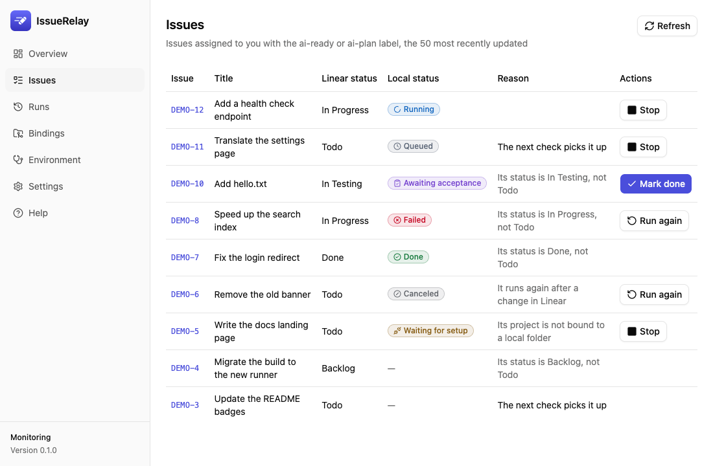
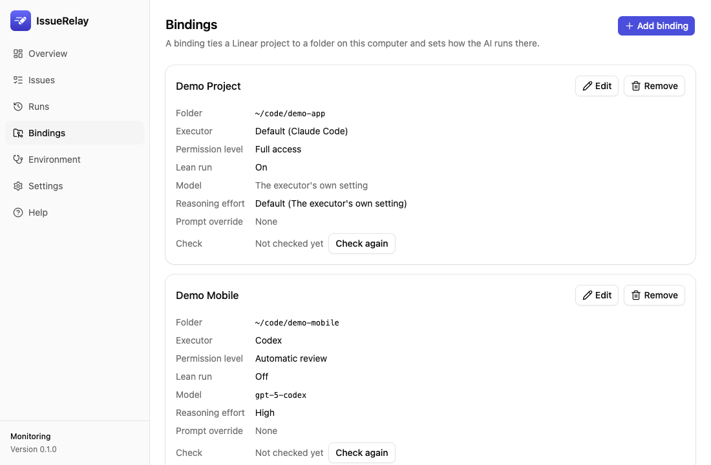

# IssueRelay

[简体中文](../../README.md) · [繁體中文](README.zh-TW.md) · [English](README.en.md) · **日本語** · [한국어](README.ko.md)

**Linear のイシューを、手元の Codex や Claude Code に割り当てるデスクトップアプリです。**

Linear でイシューを用意して実行モードを指定すると、IssueRelay はプロジェクトに紐づくローカルリポジトリを見つけ、選択した AI をバックグラウンドで起動します。進捗、結果、ログ、使用量を保存するので、実装が終わったら内容を確認して受け入れを判断できます。

0.4.0 は Apple シリコン搭載 Mac で、更新、Wiki の設定、Codex と Claude Code から同じテスト実行の進捗と結果を参照できることを確認しました。Windows のインストールとデスクトップアプリの実機検証は未実施です。公開済みの配布物はリリースページで確認できます。[GitHub Releases](https://github.com/sunkailun1992/issuerelay/releases) · [検証記録](../gates/)

## 役割と作業の流れ

| 担当 | 役割 |
|---|---|
| 利用者 | 目標と受け入れ条件を決め、実行者と権限を選び、結果を確認して完了にする |
| Linear | イシュー、担当者、ラベル、依存関係、ステータス、コメントを管理する |
| IssueRelay | 対象を見つけ、作業フォルダーに振り分け、キューから実行者を起動し、実行記録を残す |
| Codex / Claude Code | イシューとリポジトリを読み、分析・実装・テストを行い、自身のツールで Git や Linear を操作する |
| Skills とプロジェクトルール | 実行者に手順や制約を伝える。読み込まれる範囲は実行モードによって異なる |

Codex や Claude Code でイシューを準備するときは、IssueRelay の MCP を使って作業範囲と受け入れ条件を登録してから、Linear で実行ラベルを付けます。実行者は、イシューでの明示指定、プロジェクトの紐づけ、登録元のクライアント、アプリ全体のデフォルトの順で決まります。Linear から直接始める場合も、プロジェクトの紐づけとデフォルトが使えます。

IssueRelay は認可されたアカウントで公式の Linear MCP に接続し、既定では 30 秒ごとに対象を確認します。自分に割り当てられた `Todo` のイシューに `ai-plan` または `ai-ready` が付き、プロジェクトの紐づけと実行者のインストール、ログイン、環境チェックが揃うと、キューに入ります。複数の紐づけを持つプロジェクトはラベルで振り分けます。同じフォルダーでは一度に 1 件だけ実行し、全体の同時実行数にも上限を設けられます。トリガー名は設定で変更できます。

- **`ai-plan`** は要件とコードを読み、計画を Linear のコメントに書きます。計画から実装へ進むには、利用者が `ai-ready` に切り替えます。
- **`ai-ready`** は未完了の依存イシューが解消されてから、実装・検証を行い、テストブランチにプッシュして `In Testing` へ進めます。受け入れの判断と最終的な `Done` はパネルで行います。
- **実行中の変更** は監視の次の確認で反映します。イシューの取り消し、完了、担当変更、削除が検知されると、その実行のプロセスツリーを停止します。
- **セッションの再開** は、同じ実行者とフォルダーで 7 日以内などの条件を満たすと試行されます。Codex の「自動レビュー」は対象外です。パネルの「もう一度実行」は新しいセッションを開始します。

## Codex / Claude Code との MCP 接続

IssueRelay は自身の Linear 接続でイシューを検出します。実行者は自身の Linear 接続でイシューを読み、コメントやステータスを更新します。パネルの「設定 → MCP コントロールサーバー」では、これとは別に Codex と Claude Code がローカルの IssueRelay を呼び出せるよう登録します。IssueRelay を起動してからクライアントを再接続するか、新しいセッションを開いてツールを読み込みます。[インストール手順（簡体字中国語）](../install.md)

| ツール | 用途 |
|---|---|
| `status` / `list_jobs` | 監視、接続、実行状況と最近の実行を確認する |
| `pause` / `resume` / `poll_now` | 監視と新規割り当てを一時停止・再開するか、即時確認を要求する。停止中の即時確認は無効で、すでに始まった実行は継続する |
| `get_run` | 実行 ID または Linear のイシュー番号で、進捗と結果を取得する。どちらのクライアントも同じローカル記録を参照できる |
| `get_issue_context` / `set_issue_context` | イシューの背景を読み出し、リビジョンを指定して更新する。実行ラベルを付ける前に登録する |
| `get_handoff` | 引き継ぎ、独立レビュー、Wiki アーカイブ用の資料を取得する |
| `claim_handoff` / `release_handoff` | 手動で引き継ぐ間、作業フォルダーを確保する。解除には `job_id` と自分の取得した `claim_id` を使う |
| `record_archive` | 現在の Wiki フォルダーに保存済みのページとコミットの記録を登録する |

背景、引き継ぎ、アーカイブの登録はローカルの記録を更新します。実行開始の条件は Linear で設定します。「完了にする」「もう一度実行」「停止」はデスクトップパネルから操作します。[MCP の引数と使用手順（簡体字中国語）](../usage.md#用-mcp-连接主控会话)

## 0.4.0 のモデル、引き継ぎ、Wiki

- **モデルと推論強度** は設定やプロジェクトの紐づけで変更でき、カスタムモデルも入力できます。Codex の候補はローカル CLI から更新でき、対応モデルでは `Ultra` を選べます。Claude のデフォルトは `fable` です。`Ultracode` は推論強度とは別の設定です。
- **進捗と使用量** は実行詳細で確認できます。AI が報告したトークン数を表示し、Claude の料金は API 価格に基づく推定値として表示します。サブスクリプションの実際の請求は契約側で確認してください。
- **利用上限と手動の引き継ぎ** では、上限に達したことを確認できた場合に自動再実行を止めます。元の実行が終わったら作業フォルダーを確保し、保存されたチェックポイントと検証記録を使って別の Codex または Claude Code セッションで手動再開できます。
- **独立レビュー** は実行詳細からプロンプトをコピーし、新しいセッションで差分、テスト結果、受け入れ条件を照合します。
- **Wiki アーカイブ** を設定すると、要件、実装、テスト、判断をまとめるための資料をコピーできます。対象の Wiki に記録してから、現在のフォルダーに対応するアーカイブの記録を登録すると、パネルで完了にできます。フォルダーを変更したりページが削除されたりした場合は、再登録が必要です。Wiki を設定していない場合はローカル記録で管理できます。

## インストールと更新

macOS 13.3 以降では `IssueRelay_<version>_universal.dmg` を、Windows では `IssueRelay_<version>_x64-setup.exe` を使います。Windows のセットアップに管理者権限は不要です。Apple の公証や Windows のコード署名の有無は各リリースで確認してください。初回に起動が保留された場合は、ダウンロード元を確認してから、macOS では「システム設定 → プライバシーとセキュリティ → このまま開く」、Windows では「詳細情報 → 実行」で許可します。[最新リリース](https://github.com/sunkailun1992/issuerelay/releases/latest)

初回セットアップでは Linear を認可し、Codex または Claude Code の環境を確認して、Linear プロジェクトをローカルフォルダーに紐づけます。0.4.0 へ更新する前に、IssueRelay を通常の方法で終了し、アプリデータをバックアップしてください。データベースは schema 3 に移行します。以前のバージョンに戻す場合は、更新前のバックアップを使用してください。インストール後は Codex と Claude Code の MCP 接続を更新してください。[インストールとバックアップ手順（簡体字中国語）](../install.md#升级到-040-前备份数据)

## 画面

以下は架空のデータを使った英語版の画面です。簡体字中国語版とライト・ダーク表示も確認できます。[スクリーンショット一覧](../gates/screenshots/m2/)





## 実行権限とデータ

- **既定は「フルアクセス」です。** AI が利用者の権限で、確認なしに任意のコマンドを実行し、端末にある認証情報を使用できます。信頼できるリポジトリとイシューに限定し、必要に応じてプロジェクト単位で権限を下げてください。
- 実装時には `Done` への変更、メインブランチへのプッシュ、本番デプロイを避けるよう AI に指示します。これはプロンプトによる制約です。リポジトリ側のブランチ保護やデプロイ権限も設定してください。
- **既定の軽量実行** は、Linear MCP とリポジトリのルール・設定を中心に読み込みます。通常のユーザー側 MCP、プラグイン、Skills、フック、自動メモリ、Claude のユーザー設定は省かれます。Codex は `~/.codex/AGENTS.md` を引き続き読み込み、リポジトリの `.codex/` 設定は読み込みません。軽量実行ではユーザー設定にある拒否ルールやゲートウェイ設定が適用されないことがあります。「個人設定に従う」、ホームフォルダーの紐づけ、または軽量実行を解除した紐づけでは、個人設定が読み込まれます。軽量実行中も Git、SSH、CLI の認証情報にアクセスできます。
- **計画モード** は利用者の権限で無人実行されます。Claude の内蔵ツールは `Read`、`Grep`、`Glob` に制限され、Codex は読み取り専用サンドボックスで動きます。Linear の読み取り、コメント、対象イシューの更新を許可し、その他のツールは制限します。Codex のこの制限は軽量実行時に適用されます。「個人設定に従う」場合を除き、計画モードは軽量実行です。ホームフォルダーを紐づけた場合、計画モードは利用できません。計画コメントは対象イシューを閲覧できる全員に見えます。
- Linear の認証情報は OS の資格情報ストアに保存されます。IssueRelay にテレメトリーや独自のクラウド中継はありません。Linear、モデル提供元、ツールへの通信は各接続の設定に従います。[運用上の制約（簡体字中国語）](../usage.md)

## 開発とコントリビュート

Rust 1.99.0 と `rustfmt`、`clippy` を使用します。Node.js と pnpm の要件は `app/package.json` を参照してください。

```bash
rustup toolchain install
pnpm --dir app install
pnpm --dir app build
cargo test --workspace
pnpm --dir app tauri dev
```

`pnpm --dir app dev` でモックデータの画面を開けます。`pnpm --dir app test:screens` はローカルでの画面比較に使います。ヘッドレス開発ホストと CLI は、それぞれ `cargo run -p issuerelay-devhost -- --help` と `cargo run -p issuerelay-cli -- --help` で確認できます。イシューとプルリクエストを歓迎します。セキュリティに関する報告には非公開の窓口を使用してください。[開発ガイド](../../AGENTS.md) · [コントリビュート](../../CONTRIBUTING.md) · [行動規範](../../CODE_OF_CONDUCT.md) · [セキュリティ](../../SECURITY.md) · [メンテナー](../../MAINTAINERS.md)

[Apache-2.0 ライセンス](../../LICENSE)
