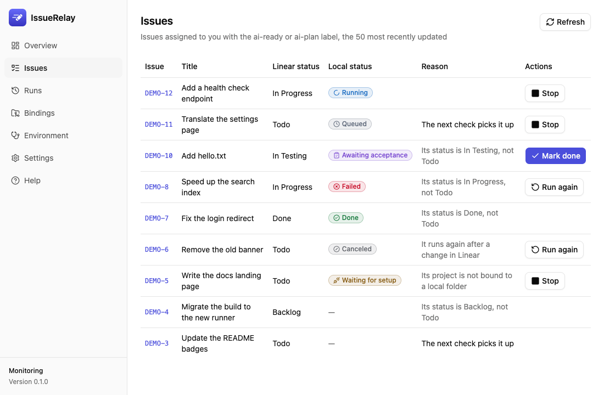
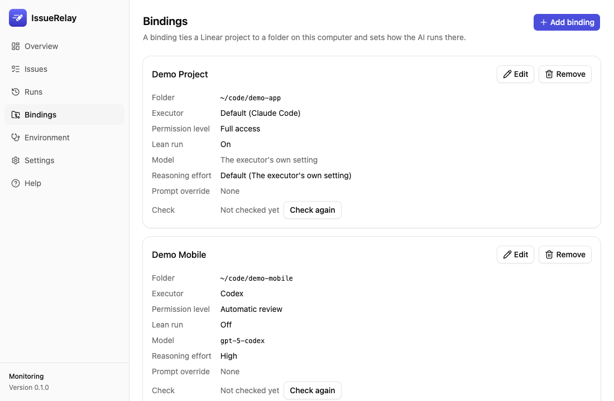

# IssueRelay

[简体中文](../../README.md) · [繁體中文](README.zh-TW.md) · [English](README.en.md) · [日本語](README.ja.md) · **한국어**

**Linear 이슈를 내 컴퓨터의 Codex나 Claude Code에 배정하는 데스크톱 작업 스케줄러입니다.**

Linear에서 이슈를 준비하고 실행 모드를 지정하면 IssueRelay가 해당 프로젝트에 연결된 로컬 저장소를 찾아 선택한 AI를 백그라운드에서 실행합니다. 진행 상황, 결과, 로그, 사용량을 기록하므로 작업이 끝난 뒤 결과를 확인하고 승인할 수 있습니다.

0.4.0은 Apple Silicon Mac에서 업데이트와 Wiki 설정을 검증했으며, Codex와 Claude Code가 같은 테스트 실행의 진행 상황과 결과를 조회하는 것도 확인했습니다. Windows 설치와 데스크톱 앱의 실기기 검증은 아직 진행하지 않았습니다. 공개된 설치 파일은 릴리스 페이지에서 확인할 수 있습니다. [GitHub 릴리스](https://github.com/sunkailun1992/issuerelay/releases) · [검증 보고서](../gates/)

## 역할과 작업 흐름

| 담당 | 역할 |
|---|---|
| 사용자 | 목표와 완료 기준을 정하고, 실행자와 권한을 선택하며, 결과를 확인하고 완료 처리 |
| Linear | 이슈, 담당자, 라벨, 의존 관계, 상태, 댓글 관리 |
| IssueRelay | 처리할 이슈 검색, 작업 폴더 배정, 대기열 및 실행 관리, 실행 기록 저장 |
| Codex / Claude Code | 이슈와 저장소를 읽고 분석·구현·테스트한 뒤, 각자의 도구로 Git과 Linear 조작 |
| Skills와 프로젝트 규칙 | 실행자에게 작업 방법과 제약을 제공하며, 실행 모드에 따라 불러오는 범위가 달라짐 |

Codex나 Claude Code에서 이슈를 준비할 때는 IssueRelay MCP로 작업 범위와 완료 기준을 등록한 뒤 Linear에서 실행 라벨을 붙입니다. 실행자는 이슈의 명시적 선택, 프로젝트 연결, 등록한 클라이언트, 앱 기본값 순으로 결정됩니다. Linear에서 직접 이슈를 준비할 때도 프로젝트 연결과 기본값을 사용할 수 있습니다.

IssueRelay는 사용자가 승인한 계정으로 공식 Linear MCP에 연결하고 기본적으로 30초마다 이슈를 확인합니다. 내게 배정된 `Todo` 이슈에 `ai-plan` 또는 `ai-ready`가 붙어 있고 프로젝트 연결, 실행기 설치와 로그인, 환경 점검이 모두 준비되면 대기열에 들어갑니다. 프로젝트 연결이 여러 개면 라벨에 따라 폴더를 선택합니다. 같은 폴더에서는 한 번에 한 건을 실행하고, 전체 동시 실행 수도 설정할 수 있습니다. 트리거 이름은 변경할 수 있습니다.

- **계획 모드**(`ai-plan`)는 요구사항과 코드를 읽고 계획을 Linear 댓글에 남깁니다. 계획을 확인한 후 사용자가 라벨을 `ai-ready`로 바꾸면 구현 단계로 넘어갑니다.
- **구현 모드**(`ai-ready`)는 완료되지 않은 선행 이슈가 해결되면 구현과 검증을 진행합니다. 테스트 브랜치에 푸시하고 `In Testing`으로 넘기며, 결과 검토와 최종 `Done` 처리는 사용자가 패널에서 합니다.
- **실행 중 변경은** 모니터링의 다음 확인 주기에 반영됩니다. 이슈가 취소 또는 완료되거나 담당자가 바뀌거나 이슈가 삭제되면 관련 프로세스 트리를 종료합니다.
- **이어서 실행은** 같은 실행자와 폴더에서 7일 이내 등 조건을 만족할 때 시도합니다. Codex의 ‘자동 검토’는 제외됩니다. 패널에서 ‘다시 실행’을 선택하면 새 세션을 시작합니다.

## Codex / Claude Code의 MCP 연결

IssueRelay는 자체 Linear 연결로 이슈를 찾습니다. 실행자는 각자의 Linear 연결로 이슈를 읽고 댓글과 상태를 업데이트합니다. 별도로 패널의 ‘설정 → MCP 제어 서버’에서 Codex와 Claude Code가 로컬 IssueRelay를 호출하도록 등록할 수 있습니다. IssueRelay를 실행한 뒤 클라이언트를 다시 연결하거나 새 세션을 열어 도구 목록을 불러오세요. [설치 가이드(중국어 간체)](../install.md)

| 도구 | 용도 |
|---|---|
| `status` / `list_jobs` | 모니터링·연결 상태와 최근 실행 기록 조회 |
| `pause` / `resume` / `poll_now` | 모니터링과 새 작업 배정을 일시 중지하거나 재개하고 즉시 확인을 요청. 일시 중지 중 즉시 확인은 실행되지 않으며, 진행 중인 작업은 계속 실행 |
| `get_run` | 실행 ID 또는 Linear 이슈 번호로 진행 상황과 결과 조회. 두 클라이언트가 같은 로컬 기록을 확인 |
| `get_issue_context` / `set_issue_context` | 이슈 배경을 조회하거나 리비전 번호를 지정해 저장. 실행 라벨을 붙이기 전에 등록 |
| `get_handoff` | 인수인계, 독립 검토, Wiki 보관 자료 조회 |
| `claim_handoff` / `release_handoff` | 수동 인수인계 동안 작업 폴더를 확보. 해제할 때는 `job_id`와 직접 받은 `claim_id` 사용 |
| `record_archive` | 현재 Wiki 폴더에 보관한 페이지와 커밋 기록 등록 |

이슈 배경, 인수인계, Wiki 보관 등록은 로컬 기록을 갱신합니다. 작업 배정 조건은 Linear에서 설정합니다. ‘완료로 표시’, ‘다시 실행’, ‘중지’는 데스크톱 패널에서 조작합니다. [MCP 매개변수와 사용 순서(중국어 간체)](../usage.md#用-mcp-连接主控会话)

## 0.4.0의 모델, 인수인계, Wiki

- **모델과 추론 강도는** 설정이나 프로젝트 연결에서 바꿀 수 있고 사용자 지정 모델도 입력할 수 있습니다. Codex 목록은 로컬 CLI에서 새로고침하며, 지원하는 모델은 `Ultra`를 선택할 수 있습니다. Claude의 기본 모델은 `fable`입니다. `Ultracode`는 추론 강도와 별도로 켤 수 있습니다.
- **진행 상황과 사용량은** 실행 상세에서 확인할 수 있습니다. 실행자가 보고한 토큰 수를 표시하고 Claude 비용은 API 요금을 기준으로 추정합니다. 구독 요금은 실제 청구 내역에서 확인하세요.
- **한도 소진이 확인되면** 자동 재실행을 중단합니다. 기존 실행이 끝난 뒤 작업 폴더를 확보하고, 저장된 체크포인트와 검증 기록을 새 Codex 또는 Claude Code 세션에 넘겨 수동으로 작업을 이어갈 수 있습니다.
- **독립 검토는** 실행 상세에서 프롬프트를 복사해 새 세션으로 진행합니다. 변경 사항, 테스트 결과, 완료 기준을 서로 대조할 수 있습니다.
- **Wiki 보관을** 설정하면 요구사항, 구현, 테스트, 결정 사항을 정리할 자료를 복사할 수 있습니다. 대상 Wiki에 기록하고 현재 폴더의 보관 기록을 등록하면 패널에서 완료로 표시할 수 있습니다. 폴더가 바뀌거나 보관 페이지가 사라지면 다시 등록해야 합니다. Wiki를 설정하지 않으면 실행 기록은 로컬에 남습니다.

## 설치와 업데이트

macOS 13.3 이상은 `IssueRelay_<version>_universal.dmg`, Windows는 `IssueRelay_<version>_x64-setup.exe`를 사용하세요. Windows 설치에 관리자 권한은 필요하지 않습니다. Apple 공증과 Windows 코드 서명 여부는 각 릴리스에 표시됩니다. 처음 실행할 때 시스템에서 차단하면 다운로드 출처를 확인한 뒤 macOS의 ‘시스템 설정 → 개인정보 보호 및 보안 → 확인 없이 열기’ 또는 Windows의 ‘추가 정보 → 실행’을 선택하세요. [최신 릴리스](https://github.com/sunkailun1992/issuerelay/releases/latest)

초기 설정에서 Linear 연결을 승인하고 Codex나 Claude Code 환경을 점검한 뒤, Linear 프로젝트를 로컬 폴더에 연결하세요. 0.4.0으로 업데이트하기 전에 IssueRelay를 정상 종료하고 앱 데이터를 백업하세요. 업데이트 중 데이터베이스가 schema 3으로 마이그레이션됩니다. 이전 버전으로 돌아갈 때는 업데이트 전 백업을 사용하세요. 설치가 끝나면 Codex와 Claude Code의 MCP를 다시 연결하세요. [설치와 백업 방법(중국어 간체)](../install.md#升级到-040-前备份数据)

## 화면

아래는 가상 데이터를 사용한 영어 화면입니다. 중국어 간체 화면과 밝은·어두운 테마도 볼 수 있습니다. [스크린샷 모음](../gates/screenshots/m2/)





## 실행 권한과 데이터

- **기본 권한은 ‘전체 권한’입니다.** AI는 사용자 권한으로 확인 없이 명령을 실행하고 컴퓨터에 저장된 인증 정보를 사용할 수 있습니다. 신뢰하는 저장소와 이슈에서만 사용하고, 필요에 따라 프로젝트별 권한을 낮추세요.
- 구현할 때는 `Done` 처리, 기본 브랜치 푸시, 프로덕션 배포를 피하도록 AI에 지시합니다. 이 제약은 프롬프트로 적용됩니다. 저장소의 브랜치 보호와 배포 권한도 설정하세요.
- **기본 경량 실행은** Linear MCP와 저장소의 규칙 및 설정을 중심으로 불러옵니다. 다른 사용자 MCP, 플러그인, Skills, 훅, 자동 메모리와 Claude 사용자 설정은 제외됩니다. Codex는 `~/.codex/AGENTS.md`를 계속 읽으며 저장소의 `.codex/` 설정은 적용하지 않습니다. 경량 실행에서는 사용자 설정의 명령 차단과 게이트웨이 설정이 적용되지 않을 수 있습니다. ‘개인 설정에 따름’을 선택하거나 홈 폴더를 연결하거나 경량 실행을 끄면 개인 설정을 불러옵니다. 경량 실행에서도 Git, SSH, CLI 인증 정보에 접근할 수 있습니다.
- **계획 모드는** 사용자 권한으로 무인 실행됩니다. Claude 내장 도구는 `Read`, `Grep`, `Glob`으로 제한되고 Codex는 읽기 전용 샌드박스를 사용합니다. Linear의 읽기, 댓글 작성, 해당 이슈 수정은 허용하고 그 밖의 도구는 제한합니다. Codex의 Linear 도구 제한은 경량 실행에서 적용됩니다. ‘개인 설정에 따름’을 제외하면 계획 모드는 경량으로 실행됩니다. 홈 폴더를 연결한 경우 계획 모드를 사용할 수 없습니다. 계획 댓글은 이슈를 볼 수 있는 사용자에게 공개됩니다.
- Linear 인증 정보는 운영체제의 자격 증명 저장소에 저장됩니다. IssueRelay는 원격 분석이나 자체 클라우드 중계 서비스를 사용하지 않습니다. Linear, 모델 제공자와 도구에 전송되는 데이터는 각 연결 설정에 따릅니다. [운영 범위(중국어 간체)](../usage.md)

## 개발과 기여

Rust 1.99.0과 `rustfmt`, `clippy`를 사용합니다. Node.js와 pnpm 요구사항은 `app/package.json`을 확인하세요.

```bash
rustup toolchain install
pnpm --dir app install
pnpm --dir app build
cargo test --workspace
pnpm --dir app tauri dev
```

`pnpm --dir app dev`로 브라우저에서 가상 데이터를 확인할 수 있고, `pnpm --dir app test:screens`로 로컬 스크린샷을 비교할 수 있습니다. 개발용 헤드리스 호스트와 CLI는 각각 `cargo run -p issuerelay-devhost -- --help`, `cargo run -p issuerelay-cli -- --help`로 확인하세요. 이슈와 PR을 환영합니다. 보안 문제는 비공개 신고 절차를 이용하세요. [개발 가이드](../../AGENTS.md) · [기여 가이드](../../CONTRIBUTING.md) · [행동 강령](../../CODE_OF_CONDUCT.md) · [보안](../../SECURITY.md) · [유지보수](../../MAINTAINERS.md)

[Apache-2.0 라이선스](../../LICENSE)
