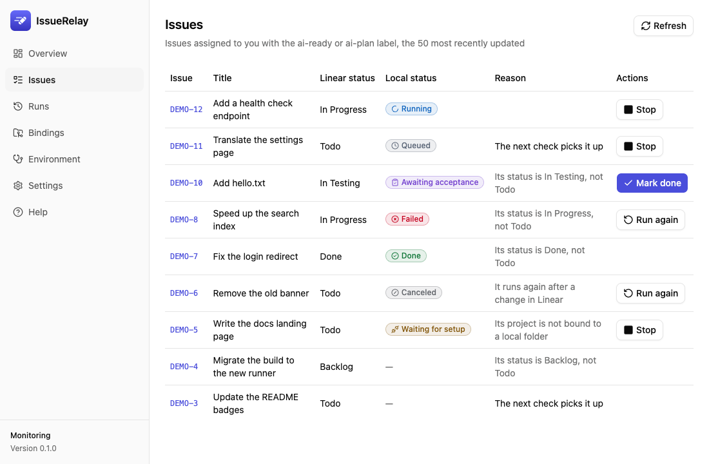
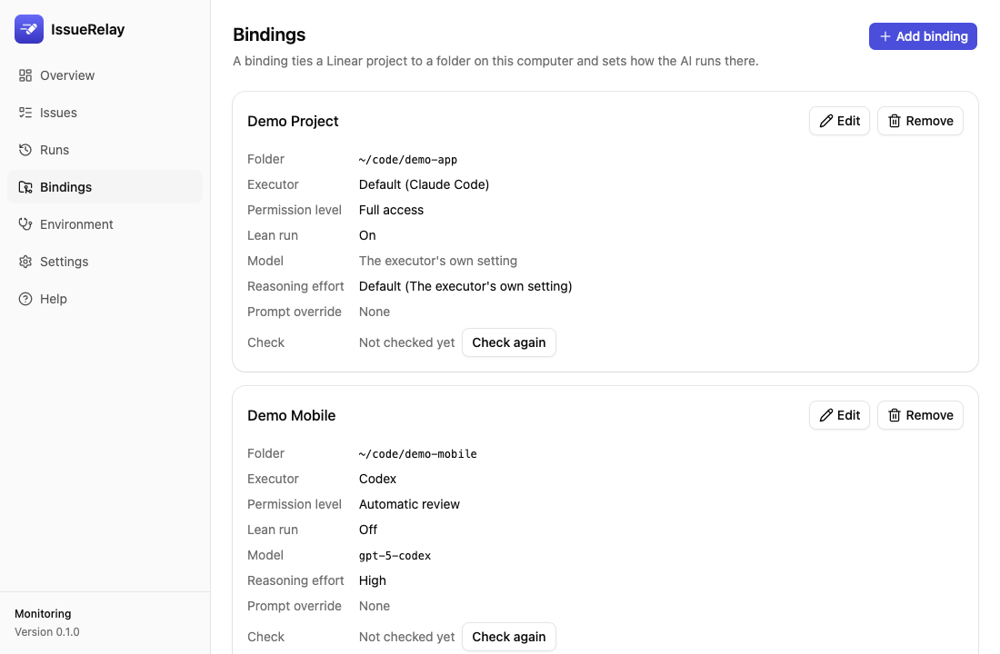

# IssueRelay

[简体中文](../../README.md) · **繁體中文** · [English](README.en.md) · [日本語](README.ja.md) · [한국어](README.ko.md)

**連接 Linear 與本機 Codex / Claude Code 的桌面任務排程工具。**

在 Linear 準備需求並選擇執行模式後，IssueRelay 會依專案綁定找到本機儲存庫，啟動選定的程式設計 AI，並保留執行狀態、摘要、記錄與用量，供你追蹤與驗收。詳細步驟請見[使用指南（簡體中文）](../usage.md)和[安裝說明（簡體中文）](../install.md)。

> **驗證範圍：** 0.4.0 已在 Apple silicon Mac 上驗證升級、Wiki 設定，以及 Codex 和 Claude Code 對同一筆合成執行的查詢。Windows 安裝與桌面操作仍待實機驗收。各版本的發布與驗證結果見 [GitHub Releases](https://github.com/sunkailun1992/issuerelay/releases)及[驗收報告](../gates/)。

## 角色與流程

| 角色 | 職責 |
|---|---|
| 你 | 確認需求範圍、驗收條件、執行者與權限，並驗收結果 |
| Linear | 保存需求、指派、標籤、依賴、狀態與討論 |
| IssueRelay | 檢查需求條件、依專案分流和排隊、啟動執行者並記錄進度 |
| Codex / Claude Code | 讀取需求及儲存庫，提出方案或實作，操作 git、測試和 Linear |
| Skills 與專案規則 | 提供工作方式與限制，實際載入範圍依執行模式而定 |

你可以先在 Codex 或 Claude Code 整理需求，透過 IssueRelay MCP 登記範圍及驗收條件，再到 Linear 加上執行標籤。執行者依序採用需求明確指定、專案綁定、登記來源和全域預設。直接在 Linear 準備的需求則依綁定與全域設定處理。

```text
Linear 需求 → 檢查條件與依賴 → 分流、排隊並啟動執行者
                 ├─ ai-plan  → 讀取需求和程式碼 → 將方案寫入 Linear 留言
                 └─ ai-ready → 實作、測試並推送測試分支 → In Testing
                                                          ↓
                                        你驗收 → 視設定歸檔 → 在面板標記完成
```

預設每 30 秒經 Linear 官方 MCP 檢查需求。同一個本機目錄一次只執行一筆，總並行數可調整。自動接單須同時符合下列條件：

1. 需求指派給你，狀態為 `Todo`。
2. 使用 `ai-plan` 只產出方案，或使用 `ai-ready` 執行開發。
3. Linear 專案已綁定本機目錄。同一專案有多個綁定時，依分流標籤選擇。
4. 執行者已安裝、登入，並通過該模式的環境檢查。

開發需求會等待未完成的阻塞依賴。方案模式可先提出方案，再由你決定何時切換到開發。觸發狀態和標籤可在設定調整。

## MCP 與執行進度

IssueRelay 透過 **Linear MCP** 尋找需求，執行者的 Linear 連線另行設定。Codex 和 Claude Code 可透過 **IssueRelay MCP** 讀取同一部電腦上的執行記錄。在「設定 → MCP 控制服務」註冊後保持桌面程式執行。新版本安裝後請重新連線以讀取工具清單。

| 工具 | 用途 |
|---|---|
| `status` / `list_jobs` | 檢視監控狀態及近期執行 |
| `pause` / `resume` / `poll_now` | 暫停、恢復監控或立即檢查。暫停後執行中的工作會繼續 |
| `get_run` | 依本機執行 ID 或目前 Linear 工作區的需求編號查詢狀態、檢查點及結果 |
| `get_issue_context` / `set_issue_context` | 讀取需求或在加上執行標籤前依修訂編號登記上下文 |
| `get_handoff` | 讀取交接、獨立複核與 Wiki 歸檔資料 |
| `claim_handoff` / `release_handoff` | 為手動接續保留目錄，完成後以該次 `claim_id` 釋放 |
| `record_archive` | 登記目前 Wiki 目錄下的歸檔頁面與提交回執 |

依本機執行 ID 查詢時，Linear 暫時離線仍可讀取。標記完成、重新執行和停止單次執行由桌面面板處理。

## 模型、交接與歸檔

- **模型與推理力度**：全域及各綁定可設定模型。Codex 會讀取本機 CLI 模型清單，相容模型可選 Ultra。Claude 的 Ultracode 可獨立開啟。
- **額度耗盡**：IssueRelay 在執行期間保留結構化檢查點，辨識到明確的額度事件時會暫停自動重跑。原執行者停止後，可領取交接並在新會話手動接續。目錄保留期間，排程器會等待。
- **同一執行者續跑**：需求退回重做或從方案轉開發時，符合執行者、目錄、時間與模式條件才會嘗試續跑。手動「重新執行」從頭開始。
- **獨立複核**：複製執行詳情中的複核提示詞，交給新會話依原需求檢查 diff、測試與驗收條件。
- **Wiki 歸檔**：指定已有的 Wiki 目錄後，可複製歸檔資料，依目標 Wiki 的規則寫入需求、實作、驗證結果和重要決定，並登記回執。面板確認完成前會核對回執。更換目錄、移除頁面或再次領取交接後須重新登記。未指定目錄時，執行記錄保存在本機。
- **用量**：顯示執行者回報的 token。Claude 的費用依 API 價格估算，訂閱扣費以服務方為準。

## 安裝與升級

從 [GitHub Releases](https://github.com/sunkailun1992/issuerelay/releases/latest) 下載安裝包。macOS 13.3 以上使用 `IssueRelay_<版本>_universal.dmg`，Windows 可用 `IssueRelay_<版本>_x64-setup.exe`。請參考各版本發布說明中的簽名狀態。macOS 15 以上如需放行，前往「系統設定 → 隱私權與安全性 → 仍要打開」。Windows SmartScreen 依提示選擇「其他資訊 → 仍要執行」。

**升級到 0.4.0 前，請正常結束 IssueRelay 並備份應用程式資料。** 新版會將執行資料庫升級至 schema 3。要回到舊版時，請使用相容的升級前備份。[安裝、備份與首次設定（簡體中文）](../install.md)

## 介面預覽

以下截圖使用內建測試資料，展示需求清單與專案綁定。更多對照圖見[介面驗收截圖](../gates/screenshots/m2/)。





## 執行權限與資料

- 預設的「完全放開」會讓 AI 以你的身分執行任意本機指令，並可使用你能存取的憑證。請依專案與需求調整權限。
- 開發執行的提示詞要求 AI 不設 Done、不推送主分支、不部署正式環境。主分支保護與儲存庫規則也應依專案設定。
- 預設精簡執行主要載入 Linear MCP 與目標儲存庫的規則和設定。使用者層的 MCP、外掛、Skills、hooks 與自動記憶通常不會載入。執行者仍能以你的身分使用 git、SSH 和本機憑證。需要個人設定、其他 MCP 或自訂服務時，請核對該綁定的精簡模式與權限。
- 方案模式限制檔案編輯。Claude 使用讀取工具，Codex 使用唯讀沙箱。依個人設定的綁定沿用你自己的設定與 Linear 工具權限。
- Linear 憑證儲存在系統鑰匙圈或 Windows 認證管理員。排程及執行記錄儲存在本機，所選 AI 和工具會依實際設定向 Linear 與模型服務傳送必要資料。

## 開發與貢獻

需要 Rust 1.99.0。桌面前端另需符合 `app/package.json` 的 Node.js 與 pnpm 版本。

```bash
pnpm --dir app install
pnpm --dir app build
cargo test --workspace
pnpm --dir app tauri dev
```

[使用指南](../usage.md) · [驗收報告](../gates/) · [開發規範](../ai-coding/README.md) · [貢獻指南](../../CONTRIBUTING.md) · [安全通報](../../SECURITY.md) · [Apache-2.0 授權](../../LICENSE)
